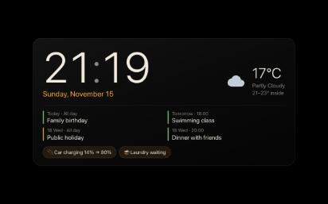

# Glass Info — a Kiosk Satellite plugin

Calm glass widgets for your [Kiosk Satellite](https://kiosksatellite.com) screensaver, fed live by Home Assistant.

- **Day:** glass cards over the photos (or any other screensaver): clock and date, weather with the inside temperature, your next events, and a row of chips for alerts plus up to four entities (alarm, car battery, power…).
- **Music:** while the full-screen Now Playing player shows, a big clock and the weather sit either side of the cover, with your alerts in a slim pill at the top.
- **Night:** a **Glass Info** screensaver mode. One glass panel on black with a big clock, the weather, the next events and the alerts. The stock widgets are hidden over it.



## Install
1. In Kiosk Satellite, open **Plugin Manager > Add repository** and enter `https://github.com/davidteles/ks-glass-info`.
2. Install **Glass Info** and trust it.
3. Fill in the settings (below).
4. For the night look, choose **Glass Info** under **Screensaver > Screensaver mode**, or in one schedule entry.

To use only these widgets, turn off the stock **Widgets** and **At a Glance** in the screensaver settings.

## Settings
| Group | Setting | What it does |
|---|---|---|
| Look | Black / Midnight, accent colour, 24-hour clock | The look of the night panel and the date line |
| Look | Hide the stock widgets | Draws the stock widgets in black while the Glass Info mode shows |
| Home Assistant | Weather entity | Temperature, condition and icon |
| Home Assistant | Inside temperature | Any sensor; its state is shown as "… inside" |
| Home Assistant | Alerts line | A sensor whose state lists alerts separated by ` · `. Each one becomes a chip; when it is empty, no alert chips show |
| Events | Calendar 1 and 2, days ahead, maximum events | Read with `calendar.get_events` every 10 minutes |
| Day widgets | Glass widgets over other screensavers | Turns the day cards on or off |
| Day widgets | Clock and weather beside Now Playing | Shows the clock, weather and alerts around the full-screen Now Playing player |
| Day widgets | Chip 1–4 (entity + name) | Numbers are rounded and shown with their unit; other states are translated (e.g. "Disarmed") |

## How it works
- **Live values:** one Home Assistant `render_template` subscription returns all of them at once.
- **Events:** fetched every 10 minutes.
- **Day cards:** a native overlay that draws only and never takes touches. It hides over the Glass Info mode itself; during full-screen Now Playing, the clock and weather move beside the cover.
- **Night panel:** an HTML screensaver renderer. Its clock runs inside the page, so it only republishes when data changes.
- **Kiosk Satellite still controls:** when the screensaver starts, brightness, the schedule, waking and pixel shift.
- **Capabilities:** `screensaver`, `screensaver.mode` (read only, to know which mode shows), `ha`, `host.read` and `overlay`.

## Build
Needs JDK 17+ and an Android SDK with platform 35 and build-tools.

```bash
python3 tools/test.py
python3 tools/build.py
```

The ZIP lands in `dist/`. Releases are built by GitHub Actions (`.github/workflows/build.yml`) when a release is published, so Kiosk Satellite can verify them.

## Credits
Built on the official [Kiosk Satellite plugin template](https://github.com/jxlarrea/kiosk-satellite-plugins) (Apache-2.0).
